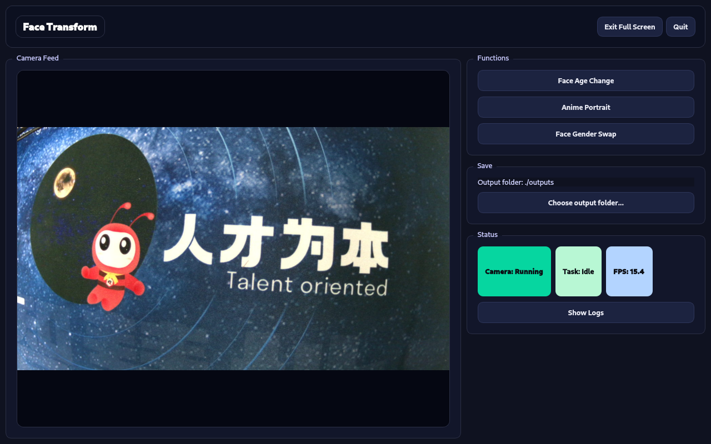

# Face Transform

[中文](./README_zh.md)| English

This document introduces the features and usage of **Face Transform**. It captures images from a USB camera and uses Tencent Cloud APIs to apply face effects. A graphical user interface is provided for quick hands-on experience. After you finish environment preparation, dependency installation, and parameter configuration according to this guide, you can run the project on the device and reproduce the corresponding face-transform effects and outputs.

Currently supported features:

1. **Face Aging**: Generate effects for different age stages and compose them into a video for playback.

2. **Portrait Anime**: Generate an anime-style portrait image.

3. **Gender Swap**: Generate a single gender-converted result using full-image processing.



## Project Structure

```
demo-face-transform/
├── docs
│   └── assets          # Static assets
│   
└── src/
    ├── main.py         # Program entry
    ├── ui_app.py       # UI, interaction, and log display
    ├── camera.py       # Camera initialization and frame capture
    ├── effects.py      # Processing pipelines for the 3 features (API call / save / preview)
    ├── tencent_api.py  # Tencent Cloud API wrapper
    ├── vision.py       # Basic vision utilities (e.g., face detection)
    ├── blend.py        # Simple image processing / color matching
    ├── downloader.py   # Download generated videos/resources to local storage
    ├── config.py       # Configuration (camera, output, parameters, etc.)
    ├── app_utils.py    # Common utilities
    └── start.sh        # Startup script
├── README.md
└── requirements.txt    # Python dependencies
```

## Hardware Requirements

- Quectel Pi H1 smart controller board
- USB camera
- Display device (DSI touchscreen)

## Software Environment Setup

- OS: Debian 13 (default OS on Quectel Pi H1)
- Python: Python 3
- Dependencies:
  - certifi==2026.1.4
  - charset-normalizer==3.4.4
  - idna==3.11
  - numpy==2.4.2
  - opencv-python-headless==4.13.0.92
  - PySide6==6.10.2
  - PySide6_Addons==6.10.2
  - PySide6_Essentials==6.10.2
  - requests==2.32.5
  - shiboken6==6.10.2
  - tencentcloud-sdk-python==3.1.44
  - urllib3==2.6.3

### Install system dependencies

```bash
sudo apt install -y python3 python3-venv python3-pip ffmpeg git vim
sudo apt install -y libxcb-cursor0 libxkbcommon-x11-0   libxcb-xinerama0 libxcb-icccm4 libxcb-image0 libxcb-keysyms1 libxcb-render-util0
```

### Create and activate a virtual environment

```bash
mkdir -p ~/Project
cd ~/Project
python3 -m venv .venv
source ~/Project/.venv/bin/activate
```

### Install Python packages

```bash
pip install -r requirements.txt
```

## Set Tencent Cloud credentials

> Enable the relevant Tencent Cloud Face Transform services (Face Gender Swap, Face Aging, Portrait Anime, Face Morphing). Record your **SECRET_ID** and **SECRET_KEY**.
>
> [Tencent Cloud Reference API Documentation](https://cloud.tencent.com/document/product/1202/41968)

```bash
export TENCENTCLOUD_SECRET_ID='...'
export TENCENTCLOUD_SECRET_KEY='...'
```

## Run

```bash
python3 main.py
```

## Contributing

Contributions to improve this project are welcome. Please follow these steps:

1. Fork this repository.
2. Create a new branch (`git checkout -b feature/your-feature`).
3. Commit your changes (`git commit -m 'Add your feature'`).
4. Push to the branch (`git push origin feature/your-feature`).
5. Open a Pull Request.

## Support

If you have any questions or need support, please refer to [Quectel Pi ](https://developer.quectel.com/doc/sbc/) or open an issue in this repository.
