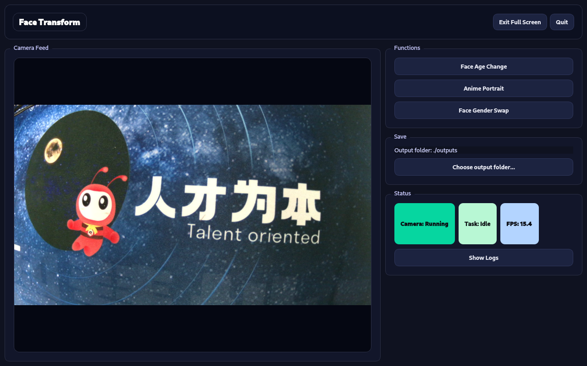

# 人脸变换

[English](./README) | 中文

介绍 **人脸变换 ** 的功能与使用方法。基于 USB 摄像头采集图像，并通过腾讯云端接口完成人脸效果处理，提供图形化界面便于用户快速体验。按照本文档步骤完成环境准备、依赖安装与参数配置后，即可在设备上运行该项目，并复现对应的人脸变换效果与输出结果。

当前支持以下功能：

1. **人脸年龄变化**：生成不同年龄阶段效果并合成视频播放

2. **人像动漫化**：生成动漫风格人像图片

3. **人脸性别转换**：整图方式生成单张性别转换结果



##  项目结构

```
demo-face-transform/
├── docs                
│   └── assets          # 静态资源文件
│   
└── src/
    ├── main.py         # 程序入口
    ├── ui_app.py       # 界面与交互、日志显示
    ├── camera.py       # 摄像头打开与取帧
    ├── effects.py      # 三个功能的处理流程（调用接口/保存/回显）
    ├── tencent_api.py  # 腾讯云接口封装
    ├── vision.py       # 人脸检测等基础视觉工具
    ├── blend.py        # 简单图像处理/颜色匹配
    ├── downloader.py   # 下载生成的视频/资源到本地
    ├── config.py       # 配置项（摄像头、输出、参数等）
    ├── app_utils.py    # 公共工具函数
    └── start.sh        # 启动脚本
├── README.md                   
└── requirements.txt    # 依赖包列表
```

##  硬件要求

- Quectel Pi H1 智能主控板
- USB 摄像头
- 显示设备（DSI 触控屏）

## 软件环境搭建

- 操作系统：Debian 13（Quectel Pi H1 默认系统）
- Python：Python 3
- 依赖组件：
  - certifi==2026.1.4
  - charset-normalizer==3.4.4
  - idna==3.11
  - numpy==2.4.2
  - opencv-python-headless==4.13.0.92
  - PySide6==6.10.2
  - PySide6_Addons==6.10.2
  - PySide6_Essentials==6.10.2
  - requests==2.32.5
  - shiboken6==6.10.2
  - tencentcloud-sdk-python==3.1.44
  - urllib3==2.6.3

### 安装系统依赖

```
sudo apt install -y python3 python3-venv python3-pip ffmpeg git vim
sudo apt install -y libxcb-cursor0 libxkbcommon-x11-0 \
  libxcb-xinerama0 libxcb-icccm4 libxcb-image0 libxcb-keysyms1 libxcb-render-util0
```


### 创建进入虚拟环境

```bash
mkdir -p ~/Project
cd ~/Project
python3 -m venv .venv
source ~/Project/.venv/bin/activate
```

###  安装python包

```
pip install -r requirements.txt
```

## 设置腾讯云密钥

> 腾讯云开通人脸变换相关服务(人脸性别转换，人脸年龄变化，人像动漫化，人像渐变)，记录好自己的**SECRET_ID**和**SECRET_KEY**
>
> [腾讯云参考API文档](https://cloud.tencent.com/document/product/1202/41968)

```bash
export TENCENTCLOUD_SECRET_ID='...'
export TENCENTCLOUD_SECRET_KEY='...'
```

## 运行
```bash
python3 main.py
```

## 贡献

我们欢迎对本项目的改进做出贡献！请按照以下步骤进行贡献：

1. Fork 此仓库。
2. 创建一个新分支（`git checkout -b feature/your-feature`）。
3. 提交您的更改（`git commit -m 'Add your feature'`）。
4. 推送到分支（`git push origin feature/your-feature`）。
5. 打开一个 Pull Request。

## 支持

如果您有任何问题或需要支持，请参阅 [Quectel Pi 文档](https://developer.quectel.com/doc/sbc/) 或在本仓库中打开一个 issue。
